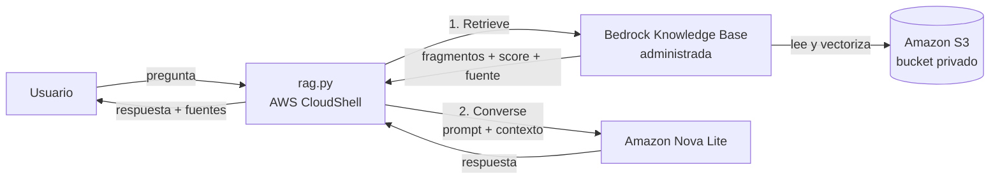

# RAG con Amazon Bedrock Knowledge Bases (administrada)

Asistente de preguntas y respuestas que responde **solo** con el contenido de un conjunto de documentos propios (guiones de AWS Sin Mapa), cita las fuentes y responde "no lo sé" cuando la información no está.

📝 Artículo con el contexto y la historia del proyecto: [Le enseñé a la IA quién soy: mi primer RAG en AWS](https://builder.aws.com/content/3Lh9EVABFK5bUf2ZiSVuwaAtBEC/le-ensene-a-la-ia-quien-soy-mi-primer-rag-en-aws) (AWS Builder Center).

## Arquitectura



| Componente | Servicio | Función |
|---|---|---|
| Almacenamiento | Amazon S3 | Documentos fuente (`.txt`) en un bucket privado |
| Búsqueda | Amazon Bedrock Knowledge Base (tipo **administrada**) | Fragmentación, embeddings, almacén vectorial y búsqueda híbrida gestionados por AWS |
| Generación | Amazon Bedrock · Amazon Nova Lite (`amazon.nova-lite-v1:0`) | Redacta la respuesta a partir del contexto recuperado |
| Ejecución | AWS CloudShell · Python 3 · boto3 | Orquesta las llamadas |

### Decisiones de diseño

- **Knowledge Base administrada en vez de una con almacén vectorial propio:** no hay que crear ni pagar un almacén vectorial (OpenSearch Serverless, S3 Vectors, etc.). Se cobra por datos indexados y por búsquedas, sin mínimo mensual.
- **`Retrieve` + `Converse` en lugar de `RetrieveAndGenerate`:** `RetrieveAndGenerate` no es compatible con Knowledge Bases administradas (`ValidationException: This operation is not supported for managed knowledge bases`). Separar los pasos además permite controlar el prompt, filtrar por `score` y reportar las fuentes.
- **Prompt restrictivo:** el modelo solo puede usar el contexto recuperado y debe responder "no lo sé" si la información no está, para reducir alucinaciones.

## Estructura del repositorio

```
.
├── rag.py            # Cliente RAG: retrieve → prompt → converse
├── documentos/       # Documentos de ejemplo para la Knowledge Base
└── README.md
```

## Requisitos

- Cuenta de AWS y región **us-east-1**.
- Acceso al modelo **Amazon Nova Lite** en Amazon Bedrock.
- Python 3.10+ y `boto3` (ya incluidos en AWS CloudShell).
- Permisos IAM para el usuario que ejecuta `rag.py`:

```json
{
  "Version": "2012-10-17",
  "Statement": [
    {
      "Effect": "Allow",
      "Action": "bedrock:Retrieve",
      "Resource": "arn:aws:bedrock:us-east-1:<ACCOUNT_ID>:knowledge-base/<KB_ID>"
    },
    {
      "Effect": "Allow",
      "Action": "bedrock:InvokeModel",
      "Resource": "arn:aws:bedrock:us-east-1::foundation-model/amazon.nova-lite-v1:0"
    }
  ]
}
```

## Despliegue

> La infraestructura se crea hoy desde la consola. La versión con infraestructura como código (AWS CDK) está en el [roadmap](#roadmap).

1. **S3:** crear un bucket con *Bloquear todo el acceso público* activado y subir el contenido de `documentos/`.
2. **Knowledge Base:** Amazon Bedrock → *Bases de conocimientos* → *Crear base de conocimiento administrada* → origen de datos Amazon S3 → seleccionar el bucket → configuración recomendada.
3. **Sincronización:** en *Origen de datos*, ejecutar *Sincronizar* y esperar el estado *Completado*.
4. Copiar el **ID de la Knowledge Base**.

## Configuración

| Variable | Obligatoria | Por defecto | Descripción |
|---|---|---|---|
| `KB_ID` | Sí | — | ID de la Knowledge Base |
| `MODEL_ID` | No | `amazon.nova-lite-v1:0` | Modelo de Bedrock para la generación |
| `AWS_REGION` | No | `us-east-1` | Región de la Knowledge Base y del modelo |
| `MIN_SCORE` | No | `0` | Puntaje mínimo para usar un fragmento (0 = sin filtro) |

## Uso

```bash
export KB_ID=<tu_knowledge_base_id>
python3 rag.py "¿Qué es AWS Sin Mapa?"
```

Salida de ejemplo:

```
Respuesta:

AWS Sin Mapa es un proyecto creado por una ingeniera de software que...

Fuentes:
- https://<bucket>.s3.amazonaws.com/que-es-aws-sin-mapa.txt

Tokens: entrada <n> · salida <n>
```

## Evaluación

Pruebas manuales sobre los 4 documentos de `documentos/`:

| Pregunta | Resultado esperado | Fuente recuperada | Resultado |
|---|---|---|---|
| ¿Qué es AWS Sin Mapa? | Describe el proyecto | `que-es-aws-sin-mapa.txt` | ✅ |
| ¿Con qué ejemplo explica AWS Sin Mapa la nube? | Netflix vs. DVD | `guion-cloud-computing.txt` | ✅ |
| ¿Qué pasa si llega Juan al equipo? (no menciona IAM) | Se agrega al grupo IAM | `guion-23-grupo-iam.txt` | ✅ |
| ¿Qué es Amazon EC2? (fuera del corpus) | "No lo sé" | `que-es-aws-sin-mapa.txt` (no usada) | ✅ con limitación |

Línea base sin RAG (Nova Lite en el Playground, misma pregunta): 7 tokens de entrada, 512 de salida, 4,2 s de latencia, y una respuesta inventada.

## Costos

- **Knowledge Base administrada:** por GB indexado al mes y por cada búsqueda; sin mínimo mensual. Con 4 documentos (5,6 KB) el costo es de centavos.
- **Nova Lite:** por tokens de entrada y salida.
- **S3:** por almacenamiento (despreciable para este volumen).

Consultar siempre la [página de precios de Amazon Bedrock](https://aws.amazon.com/bedrock/pricing/). Se recomienda un presupuesto con alertas en AWS Budgets y etiquetar los recursos (por ejemplo, `proyecto=IA-desde-0`).

## Seguridad

- Bucket privado, sin acceso público.
- Permisos mínimos: solo `bedrock:Retrieve` sobre una Knowledge Base y `bedrock:InvokeModel` sobre un modelo.
- No usar el usuario root; usar un usuario de IAM Identity Center con MFA.
- No subir al repositorio IDs de cuenta ni credenciales: la configuración va en variables de entorno.

## Limitaciones conocidas

- La búsqueda siempre devuelve los fragmentos más parecidos, aunque no sean relevantes; por eso una pregunta fuera del corpus puede listar una fuente que no se usó. Mitigación: ajustar `MIN_SCORE`.
- La evaluación es manual y con un corpus pequeño.

## Roadmap

- [ ] Infraestructura como código con **AWS CDK (Python)**: bucket, Knowledge Base administrada, origen de datos, rol IAM y sincronización.
- [ ] Calibrar `MIN_SCORE` con un conjunto de preguntas de prueba.
- [ ] Evaluación automática (precisión de recuperación y respuestas "no lo sé" correctas).
- [x] Agente que usa esta Knowledge Base como herramienta: [guionista-aws-sin-mapa](https://github.com/OshinVillegas/guionista-aws-sin-mapa).

## Limpieza

1. Amazon Bedrock → *Bases de conocimientos* → eliminar la Knowledge Base.
2. Amazon S3 → vaciar y eliminar el bucket.

---

Autora: **Oshin Villegas** · [AWS Sin Mapa](https://www.tiktok.com/@awssinmapa) · serie IA desde 0
